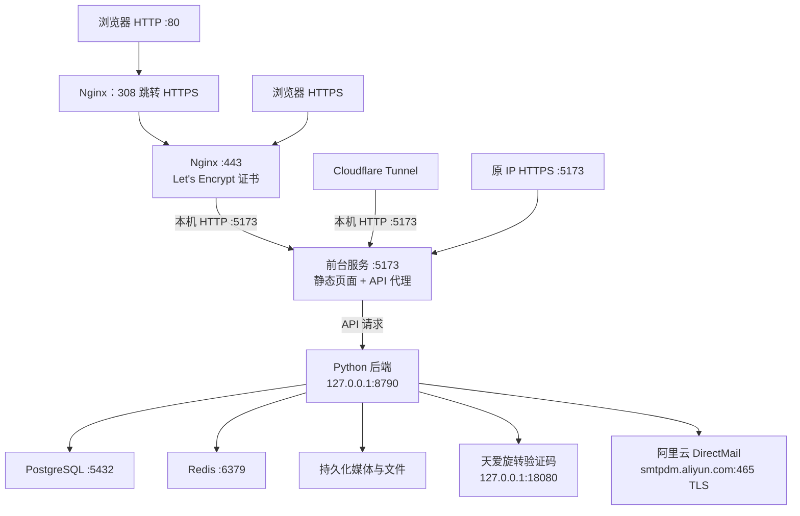

# 京东云生产部署架构

核实日期：2026-11-06（Asia/Shanghai）。本文记录该日期实机核对的部署状态；后续调整入口、服务或目录时同步更新。

## 环境概况

| 项目 | 当前配置 |
|---|---|
| 云服务器 | 京东云，`117.72.209.44` |
| 正式入口 | `https://rynenglish.com` |
| 操作系统 | CentOS 7 |
| 容器引擎 | Docker 26.1.4 |
| 服务管理 | Docker 容器 + 宿主机 systemd 219 |
| 应用安装目录 | `/srv/shiyue/` |
| 当前代码版本 | `code-20261106-113458-43116bfb` |

2026-11-05 已增加标准 HTTPS 入口，随后发布旋转验证码开关与 DirectMail 发信；保留数据库、媒体、5173 入口及 Cloudflare Tunnel。生产验证码已开启，运营后台 → 认证安全可切换。

2026-11-06 发布 RynEnglish 品牌、右上角 e 的 R/e Logo 与 slogan `Every Page, A Deeper Understanding.`，应用技术标识和目录继续使用 `shiyue` 以保持兼容；当前升级任务 #5 complete，数据库备份位于 `/srv/shiyue/backups/saas/pre-upgrade-code-20261106-113458-43116bfb.dump`。

服务器侧标准域名访问正常；本机公网域名 80/443 核验出现 JDTP403/超时，外部访问原因待确认。原公网 5173 与 Cloudflare 公网 API 返回 200，不能仅凭服务器自访问判断公网 80/443 已通过验收。

## 访问链路



- 公网 80 普通请求以 308 跳转到 `https://rynenglish.com`，保留路径和查询参数；通过公网 IP 访问 HTTP 也跳转到该域名。
- 80 的 `/.well-known/acme-challenge/` 单独用于 Let's Encrypt 域名验证，不跳转；不存在的验证文件返回 404。
- 公网 443 由 Nginx 终止 TLS，再通过本机 HTTP 代理至 5173。
- 5173 前台服务提供 React 构建页面，将 `/api/`、`/books/` 请求代理至后台 8790。
- 5173 同时支持公网 HTTPS 和仅限回环的 HTTP；Cloudflare Tunnel 原有 `http://localhost:5173` 回源保留，实测 `http://127.0.0.1:5173/` 返回 200。公网明文访问 5173 被拒绝。
- 原 `https://117.72.209.44:5173` 入口使用自建证书，访问设备需信任对应根证书。正式域名 443 使用 Let's Encrypt 证书。
- 后台、PostgreSQL 和 Redis 仅监听本机回环地址。

## 服务与容器

| 服务 / 容器 | 监听端口 | 职责 |
|---|---|---|
| `shiyue-https` | 公网 80、443 | Nginx，负责跳转、TLS 和反向代理 |
| `shiyue-saas-frontend` | 5173 | Python 前台服务，提供 React 页面及 API 代理 |
| `shiyue-saas` | `127.0.0.1:8790` | Python 业务 API，处理认证、阅读、导入、运营等功能 |
| `shiyue-postgres` | `127.0.0.1:5432` | PostgreSQL 16，保存业务数据 |
| `shiyue-redis` | `127.0.0.1:6379` | Redis 7，提供缓存等能力 |
| `shiyue-captcha` | `127.0.0.1:18080` | Java 天爱 ROTATE 生成/轨迹校验，内部密钥鉴权 |
| `cloudflared.service` | 回源本机 5173 | 宿主机 systemd 服务，运行 Cloudflare Tunnel |

Nginx、前台、后台和验证码容器使用 host 网络；PostgreSQL、Redis 使用 bridge 网络并将端口绑定到宿主机回环地址。验证码服务强制绑定回环，仅部署候选阶段临时使用 18081；以非 root、只读根目录、512 MiB 内存和 pids 128 限制运行。前台 5173 是生产入口服务，不是本地开发用的 Vite；本地 Vite 端口为 4173。

Nginx 镜像为 `nginx:1.28-alpine`，核实时版本为 1.28.3。Certbot 使用 `certbot/certbot:v5.4.0`，由安装或续期脚本按需运行。

## 应用与数据目录

| 服务器路径 | 用途 |
|---|---|
| `/srv/shiyue/current` | 当前版本软链接 |
| `/srv/shiyue/releases/` | 各次发布的代码目录 |
| `/srv/shiyue/current/reader/site/` | React 前端构建文件 |
| `/srv/shiyue/current/tools/` | Python 后端、前台服务及工具代码 |
| `/srv/shiyue/current/services/captcha/` | 天爱 Java 源码、Dockerfile 与发布 JAR |
| `/srv/shiyue/shared/config/saas.env` | 后端环境配置，包含数据库连接、应用地址及密钥等敏感配置 |
| `/srv/shiyue/shared/config/captcha.env` | 仅验证码内部共享密钥，权限 0600；saas.env 同为 0600 |
| `/srv/shiyue/shared/config/redis.conf` | Redis 配置 |
| `/srv/shiyue/shared/config/https-entry.json` | 标准 HTTPS 入口配置清单 |
| `/srv/shiyue/shared/config/dioco.local.json` | 词典相关配置 |
| `/srv/shiyue/shared/postgres/` | PostgreSQL 数据文件 |
| `/srv/shiyue/shared/redis/` | Redis 持久化文件 |
| `/srv/shiyue/shared/books/` | 书籍及关联资源 |
| `/srv/shiyue/shared/.local/` | 应用持久化工作数据 |
| `/srv/shiyue/shared/cache/` | 应用缓存 |
| `/srv/shiyue/shared/whisper/` | 语音识别模型，当前挂载 `ggml-base.en.bin` |
| `/srv/shiyue/shared/https/` | 原 5173 入口的 `rootCA.pem`、`server-cert.pem`、`server-key.pem` |
| `/srv/shiyue/backups/saas/` | 数据库备份 |
| `/srv/shiyue/backups/resources/` | 资源备份目录 |
| `/srv/shiyue/manifests/history/` | 发布清单历史目录 |

核实时，`current` 指向：

```text
/srv/shiyue/releases/code-20261106-113458-43116bfb
```

代码目录和共享数据目录分离。后台挂载当前版本的 `reader/`、`tools/`，以及共享数据、缓存、书籍、模型和备份目录；前台挂载 `reader/site/`、`tools/` 和原 5173 证书目录。

验证码开关存于 PostgreSQL `platform_settings` 的 `auth.captcha`，不写入前端或环境开关；Redis 保存短期绑定与一次性业务票据。SMTP 参数只存 `saas.env`，杭州 DirectMail 使用 `smtpdm.aliyun.com:465`、发件地址 `noreply@rynenglish.com`、显示名 `RynEnglish`；秘密不在本文记录。发信走出站 TLS，不新增邮件服务器或入站邮件端口。

## 标准 HTTPS 配置与证书

标准入口状态独立存放于应用安装目录之外，完整重新安装应用不会删除该目录。末级目录名是安装目录 SHA-256 的前 12 位。

```text
/var/lib/shiyue/https/57dfc879ad04/
├── nginx/default.conf                 # Nginx 配置
├── letsencrypt/                       # ACME 账户、证书及续期配置
│   └── live/rynenglish.com/
│       ├── fullchain.pem              # 当前证书链链接
│       └── privkey.pem                # 当前私钥链接
├── webroot/                           # HTTP ACME 验证目录
├── renew.sh                           # 续期、校验及重载脚本
├── logs/                              # Certbot 日志
├── work/                              # Certbot 工作目录
├── entry.lock                         # 安装与续期互斥锁
└── backups/                           # 入口配置变更备份
```

Nginx 容器内的挂载对应关系：

| 宿主机路径（以上述状态目录为基准） | 容器内路径 |
|---|---|
| `nginx/` | `/etc/nginx/conf.d/` |
| `letsencrypt/` | `/etc/letsencrypt/` |
| `webroot/` | `/var/www/acme/` |

Nginx 主要配置：

- `server_name rynenglish.com`。
- 80 普通请求执行 `return 308 https://rynenglish.com$request_uri`。
- 443 使用 `/etc/letsencrypt/live/rynenglish.com/fullchain.pem` 和 `privkey.pem`。
- 开启 TLS 1.2、TLS 1.3，代理至 `http://127.0.0.1:5173`，传递原 Host、客户端地址及 HTTPS 转发头。
- 上传请求体上限 `20g`，关闭代理请求和响应缓冲；客户端请求体、代理读写超时为 600 秒。

核实时证书有效至 **2027-02-03 02:11:59 UTC**；该日期随实际续期更新。

## 自动续期与 Cloudflare Tunnel

续期由以下宿主机 systemd 文件管理：

```text
/etc/systemd/system/shiyue-https-renew-57dfc879ad04.timer
/etc/systemd/system/shiyue-https-renew-57dfc879ad04.service
```

timer 每天服务器本地时间 **03:00、15:00** 检查，配置 `Persistent=true`，证书到续期窗口时才更新。续期成功后校验并重载 Nginx；安装和续期共用文件锁。核实时 timer 已启用并运行，实际续期 dry-run 和 systemd 服务均验证成功。续期 service 是按需执行的任务，正常执行结束后的 `inactive` 不代表 timer 故障。

Cloudflare Tunnel 配置位置：

| 路径 | 用途 |
|---|---|
| `/etc/systemd/system/cloudflared.service` | Tunnel 服务定义 |
| `/etc/cloudflared/token` | Tunnel 运行凭据，不在本文记录内容 |

核实时 `cloudflared` 为 enabled/active，原本机 5173 回源正常。公网域名映射由 Cloudflare 侧配置管理，本文不推定未重新核实的 Tunnel 公网域名。

## 常用只读运维命令

以下命令在服务器上执行。

```bash
# 容器及当前版本
docker ps
readlink -f /srv/shiyue/current

# 后端、前台和 Nginx 日志
docker logs --tail 100 shiyue-saas
docker logs --tail 100 shiyue-saas-frontend
docker logs --tail 100 shiyue-https

# Nginx 配置校验
docker exec shiyue-https nginx -t

# 本机后台健康与 Tunnel 回源
curl --fail --max-time 10 http://127.0.0.1:8790/api/health
curl --fail --max-time 10 -o /dev/null -w '%{http_code}\n' http://127.0.0.1:5173/

# 公网 HTTP 跳转与 HTTPS 健康；保留正常证书验证
curl -I --max-time 15 http://rynenglish.com/
curl --fail --max-time 15 https://rynenglish.com/api/health

# 续期计划与执行日志
systemctl list-timers 'shiyue-https*'
journalctl -u shiyue-https-renew-57dfc879ad04.service -n 100 --no-pager

# Cloudflare Tunnel 状态与日志
systemctl status cloudflared --no-pager
journalctl -u cloudflared -n 100 --no-pager
```

## 部署操作与源码入口

- **程序升级**：先备份远端 PostgreSQL，再准备候选版本、应用迁移并进行健康检查，成功后切换代码；保留远端用户数据。
- **重新部署**：完整重装，使用本机数据库快照初始化远端，会替换线上用户数据。
- **上传官方内容**：增量同步官方读物及关联媒体，不发布代码、不覆盖用户数据；新增或变更内容需在线上审核。
- **仅调整 HTTPS 入口**：`tools/deploy_remote.py --https-entry`，不打包或发布业务代码，不重新初始化数据库。

| 仓库文件 | 职责 |
|---|---|
| `tools/deployment/https_entry.py` | 生成标准入口、证书安装、自动续期和回滚逻辑 |
| `tools/deployment/captcha.py` | 构建/安装 Java 验证码服务、内部密钥、候选健康检查与切换 |
| `tools/deployment/manager.py` | 安装、升级、候选版本和部署任务管理 |
| `tools/deploy_remote.py` | 命令行部署入口 |
| `tools/saas_frontend_server.py` | 前台静态页面服务和 API 代理 |
| `tools/reader_server.py`、`tools/saas_*.py` | Python 后端业务 |
| `frontend/src/pages/PlatformOperationsPage.jsx` | 平台部署页面、域名设置和操作确认 |

相关状态与验证记录见 [HANDOFF.md](HANDOFF.md)。
